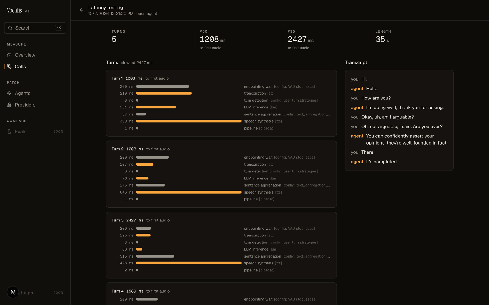
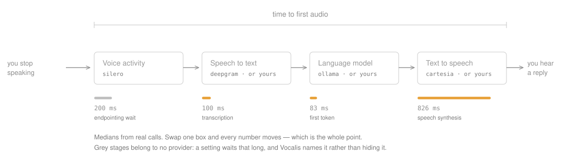
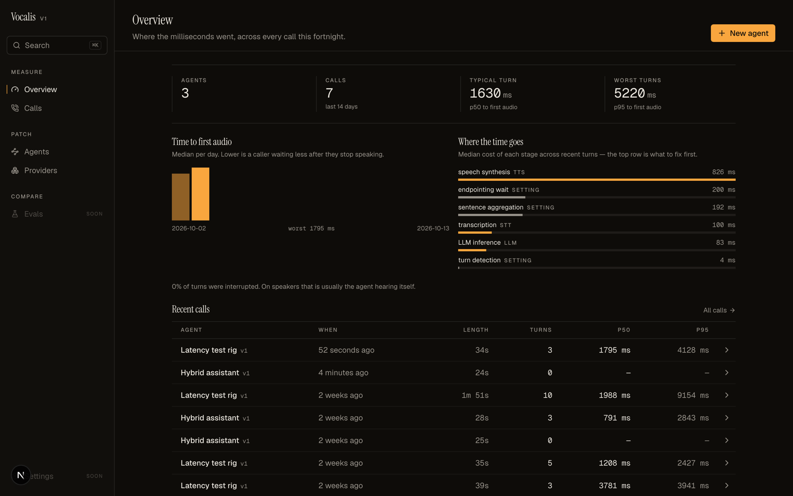
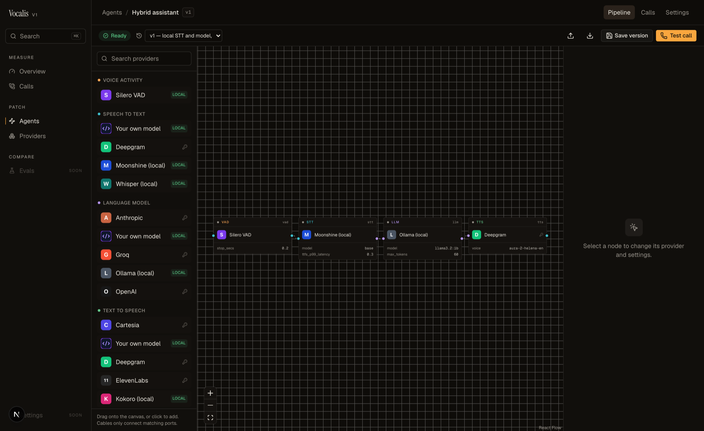

# Vocalis

**A benchmark harness for voice pipelines.** Patch any model into any stage, place a
real call, and see exactly where the milliseconds went.

Built on [Pipecat](https://github.com/pipecat-ai/pipecat). Runs anywhere Docker runs.



---

## The problem

A voice agent is a relay race: voice activity detection hands to speech-to-text,
which hands to a model, which hands to a voice. Each leg has its own vendor, its own
latency, and its own failure mode — and the caller only ever experiences the sum.

So when a reply takes three seconds, the useful question isn't "is it slow?" It's
**which leg, and by how much?** Provider dashboards can't answer that: each one sees
only its own hop. Neither can the frameworks, which are built to run pipelines rather
than measure them. The time nobody owns — silence a VAD waits out, a grace window for
a late transcript, a turn detector deciding you've finished speaking — belongs to no
vendor at all, and that is usually where the seconds are.



## What Vocalis does

Every turn is broken into named stages that **add up to the total**, each attributed
to the node that owns it:

```
turn 2: 843 ms to first audio
     120 ms  ████████                    endpointing wait     [config: VAD stop_secs]
      96 ms  ██████                      transcription        [stt]  1.9x realtime
     284 ms  ███████████████████         LLM inference        [llm]  62.5 tok/s
     343 ms  ████████████████████████    speech synthesis     [tts]  380 chars/s

4 turns   p50 861 ms   p95 1204 ms
```

Three things fall out of that shape:

- **Nothing hides between the stages.** The first row is a setting, not a service.
  Measuring this repo's own example found a **900 ms grace window** nobody had set
  and a turn detector stalling **three seconds** on utterances it judged unfinished.
- **Throughput sits beside latency**, because a model that answers in four words
  isn't faster than one that answers in forty — it's terser. Tokens per second for a
  model, characters per second for a voice, and a realtime factor for speech
  generation, where below 1× means it can never keep up with a live call.
- **Every call stores the config that produced it**, so two runs are comparable even
  after you've edited the agent.

Across calls it adds up to one ranking: the stage to fix first.



## Bring your own model

Every stage accepts a **custom endpoint**, so a model you're serving yourself can be
measured in a real conversation, beside providers you already trust:

```json
{
  "id": "llm",
  "type": "llm",
  "provider": "custom",
  "system_prompt": "Answer in one short sentence.",
  "params": {
    "base_url": "http://localhost:8000/v1",
    "model": "my-model",
    "api_key_env": "MY_MODEL_API_KEY"
  }
}
```

That covers vLLM, llama.cpp, LM Studio, SGLang, TGI and anything else speaking the
OpenAI shape — chat completions for `llm`, transcriptions for `stt`, speech for
`tts`. Keys are *named*, never embedded: the config says which environment variable
to read, so it stays safe to share.

Swap one stage, call again, compare the logs. That's the whole workflow — and the
canvas is where the swapping happens. Cables only connect matching ports, so a
pipeline that wouldn't run can't be drawn.



## Quickstart

Requires [Docker](https://docs.docker.com/get-started/) (Desktop, Colima, OrbStack —
any of them) and [uv](https://docs.astral.sh/uv/).

```bash
./deploy/up.sh
```

Open [localhost:3000](http://localhost:3000). One command brings up the canvas, the
runtime and Postgres, migrations included.

Postgres and the canvas run in containers; the runtime runs on your machine, because
a browser call carries its audio over UDP and Docker forwards only TCP. In a container
the call connects, the transcript appears, and no voice ever arrives — so the piece
that needs the network moves out, and the rest stays in Docker.

**No API keys?** Start from the **Local** template: Silero VAD, Moonshine speech to
text, a model through Ollama, and Kokoro speech — all on your machine, nothing to
sign up for. Or run it from the terminal, no browser at all:

```bash
uv sync --extra local
uv run vocalis run examples/local.json --metrics
```

## What's in the box

| Stage | Providers |
| ----- | --------- |
| Voice activity | Silero |
| Speech to text | Deepgram, Whisper (local), Moonshine (local), **your own endpoint** |
| Language model | OpenAI, Anthropic, Groq, Ollama (local), **your own endpoint** |
| Text to speech | Cartesia, ElevenLabs, Deepgram, Kokoro (local), **your own endpoint** |

Adding one is a folder: a manifest, an adapter, an icon. The manifest drives the
palette, the settings form and the validation, so nothing in the dashboard needs
touching. See [providers/README.md](providers/README.md).

## How it works

**The config is the contract.** A JSON file describes the nodes and the cables
between them. The canvas edits it, the runtime compiles it into a Pipecat pipeline,
the CLI runs it without a browser, and every call log keeps a copy. Its
[JSON Schema](schema/) is the single source of truth — the dashboard's TypeScript
types are generated from it, and the port rules that decide which cables may connect
are read from it by both sides.

**Problems name the node.** Validation runs the same checks whether you're editing on
the canvas, saving through the API, or running from the terminal:

```
examples/broken.json: invalid agent config (2 problems)
  - node "llm": "vad" outputs audio but "llm" takes text input
  - node "tts": unknown tts provider "elevenlab" (available: cartesia, deepgram, elevenlabs, kokoro)
```

**Measurement is an observer**, not a fork. Vocalis wraps Pipecat's own latency and
turn observers and maps every measurement back to a node on the canvas, so it
composes with a pipeline you already have.

## Repo layout

| Path | What lives there |
| ---- | ---------------- |
| `schema/` | JSON Schema for agent configs and provider manifests — the contract |
| `runtime/` | Compiler, tracing, call storage, HTTP API |
| `providers/` | Provider plugins: manifest + adapter + icon |
| `dashboard/` | The canvas, call logs and analytics (Next.js) |
| `cli/` | `vocalis run agent.json --metrics` |
| `deploy/` | `docker compose up` |
| `examples/` | Agents you can run today, including a fully local one |

## Status

Working today: the canvas, versioned agents, browser test calls, per-turn tracing
with throughput, call logs, custom endpoints, and a local no-keys path.

Next: **turn detection as a setting**, so the three seconds a turn detector spends
deciding you've finished is a number you can move. Then **comparison runs** — a
scripted caller, the same script against two configs, and a verdict on whether a
change actually helped. Then **full duplex**, where the agent listens while it
speaks, measured on the same harness as the cascade.

Not planned: telephony, hosting, auth. This is an instrument, not a platform.

## Development

Python 3.12 with [uv](https://docs.astral.sh/uv/), Node with pnpm.

```bash
uv sync --all-extras              # runtime, CLI, local models
uv run pytest                     # database tests skip without Postgres
uv run ruff check .

pnpm --dir dashboard install
pnpm --dir dashboard test
pnpm --dir dashboard gen:schema   # regenerate TS types after a schema change
```

```bash
docker compose -f deploy/docker-compose.yml up -d postgres   # for the database tests
```

## License

[MIT](LICENSE)
